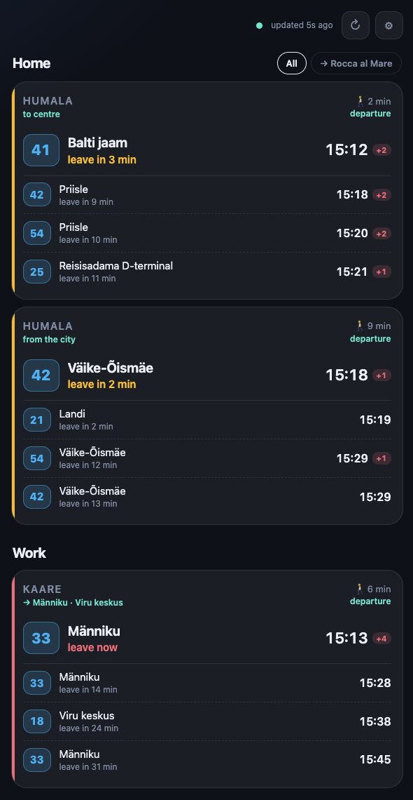
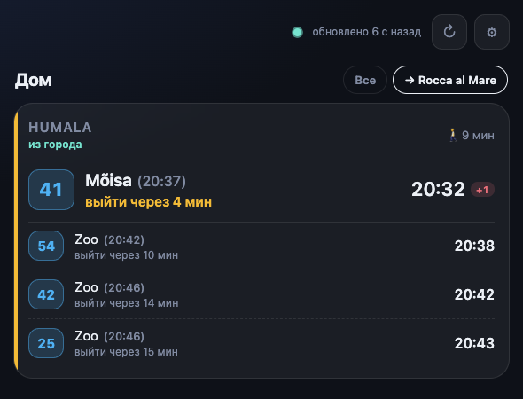
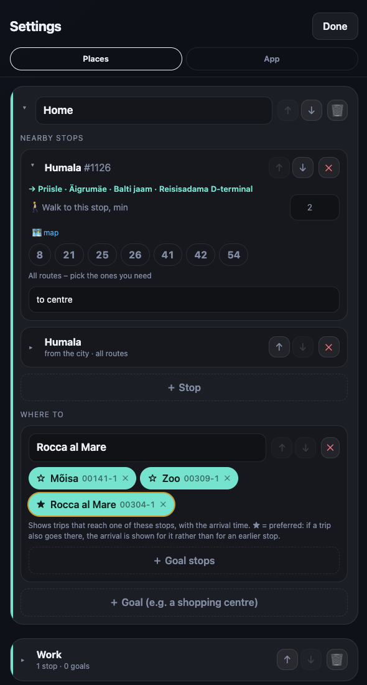
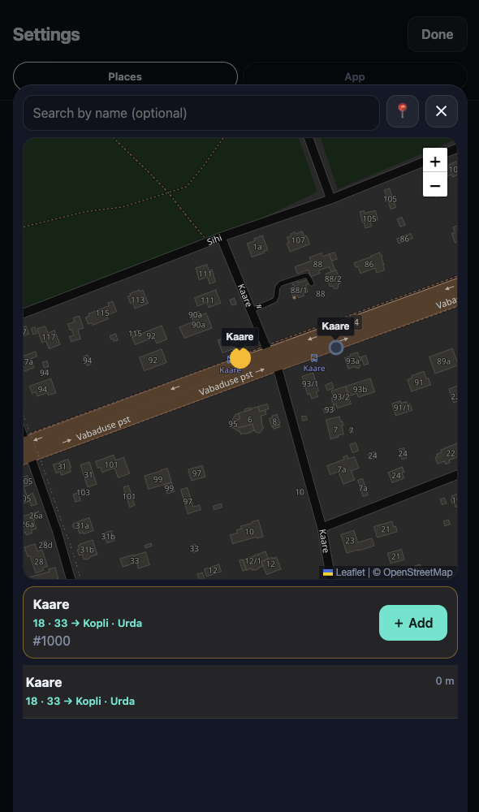

<div align="center">

# Sõiduk

**Когда выходить из дома, чтобы успеть на автобус, трамвай или троллейбус в Таллине.**

Задайте остановки рядом с домом и работой один раз, а дальше открывайте и сразу видите:
какой транспорт приедет и через сколько минут нужно выйти.

[](https://ne1r0n.github.io/soiduk/)
[](https://github.com/ne1r0n/soiduk/actions/workflows/pages.yml)
[](LICENSE)

<br />

&nbsp;&nbsp;

</div>

---

## Что умеет

- **Одним взглядом.** Для каждой остановки крупно показан ближайший рейс и подпись «выйти через N мин». Цвет подсказывает срочность: бирюзовый, жёлтый (меньше 5 минут), красный («выйти сейчас»).
- **У каждой остановки своё время пешком.** Две остановки с одним названием по разным сторонам дороги не смешиваются: у них отдельные карточки, направление и время ходьбы.
- **Реальное время.** Данные идут из прогноза по GPS транспорта. Значок `+3` или `−1` показывает опоздание или опережение относительно расписания.
- **«Куда еду».** Задайте цель, например торговый центр с несколькими остановками, и увидите только те рейсы, которые до неё доедут, и **во сколько вы будете на месте**. Звёздочкой ★ можно отметить предпочтительную остановку цели.
- **Остановки на карте.** Не нужно знать названия: нажимаете на остановку на карте и видите, куда она идёт.
- **Свой набор.** Несколько локаций (дом, работа), любое число остановок и целей, выбор нужных маршрутов, пометки на карточках.
- **Резервная копия.** Настройки можно «Поделиться» создаёт ссылку для другого устройства или друга, «Экспорт» и «Импорт» работают с файлом, а замену настроек можно отменить кнопкой «Вернуть предыдущие».
- **Как приложение.** Откройте сайт на телефоне и выберите «На экран “Домой”»: появится иконка и полноэкранный режим.

<div align="center">
&nbsp;&nbsp;
</div>

## Как это работает

Сервера у приложения нет. Это статическая страница (TypeScript и Vite), которая работает целиком в браузере:

| Что | Откуда |
|---|---|
| Отправления в реальном времени | `transport.tallinn.ee/siri-stop-departures.php`, запросы идут прямо из браузера |
| Остановки и расписание | `transport.tallinn.ee/data/stops.txt` и `gtfs.zip`, собираются при каждой публикации и обновляются ночью |
| Карта | [OpenStreetMap](https://www.openstreetmap.org/copyright) |
| Ваши настройки | `localStorage` браузера, никуда не отправляются |

Время прибытия на цель считается так: живое отправление с вашей остановки плюс время в пути из расписания (GTFS). Рейс находится по ближайшему времени в пределах 150 секунд, потому что живой прогноз и расписание расходятся на десятки секунд.

## Запуск у себя

Нужен Node.js 22 или новее.

```bash
npm install
npm run setup   # скачать остановки и расписание (public/stops.json, public/gtfs.json)
npm run dev     # http://localhost:5173
npm test        # тесты
npm run build   # статическая сборка в dist/
```

Версия берётся из `package.json` (`npm version patch` поднимает её) и показывается внизу экрана настроек вместе с коммитом и датой сборки.

Свою копию можно опубликовать на GitHub Pages: сделайте форк, откройте *Settings → Pages* и выберите источник *GitHub Actions*. Workflow `.github/workflows/pages.yml` соберёт сайт сам и будет обновлять расписание каждую ночь.

## Поддержать автора

Sõiduk делается в свободное время и бесплатен для всех. Если он сэкономил вам пару минут на остановке, можно угостить автора кофе:

<div align="center">

[](https://ko-fi.com/ne1r0n)

</div>

Помогает и бесплатное: поставьте ⭐ репозиторию и расскажите о приложении тем, кто ездит по Таллину.

## Обратная связь

Нашли ошибку или есть идея? [Создайте обращение](https://github.com/ne1r0n/soiduk/issues/new/choose). Для ошибки полезно указать устройство, браузер и остановку, на которой она проявилась. Предложения по коду тоже приветствуются: достаточно открыть pull request.

## Данные и благодарности

Данные об остановках, расписании и положении транспорта принадлежат Таллинну (`transport.tallinn.ee`). Формат живых данных не документирован, поэтому он может измениться без предупреждения. Карта © участники [OpenStreetMap](https://www.openstreetmap.org/copyright). Проект неофициальный и никак не связан с транспортным департаментом Таллина.

## Лицензия

[MIT](LICENSE). Лицензия относится к коду приложения, но не к данным Таллина и не к картографическим данным.
